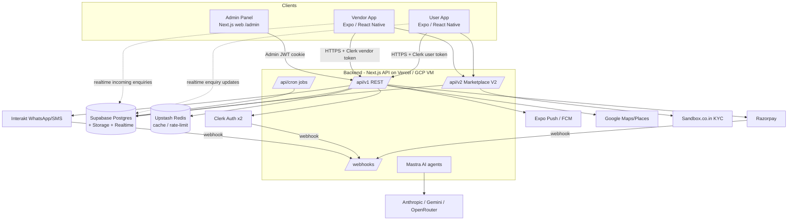

# 1. System Overview

## High-level architecture



## Hierarchy (top to bottom)

```
Ekatraa Platform
├── Backend (Next.js)
│   ├── API v1  ─ user / vendor / staff / admin / public / chat / webhooks
│   ├── API v2  ─ marketplace: services, variants, bundles, drafts, KYC, event discovery
│   ├── Cron jobs (reassignment, dunning, KYC sweep, retention…)
│   ├── Admin Panel UI (/admin)
│   ├── AI layer (Mastra agents, vendor AI, chat briefs)
│   └── Database (Supabase Postgres, 264 migrations)
├── User App (customer)
│   ├── Auth & onboarding (phone OTP, PIN, guest mode)
│   ├── Discovery (home, search, categories, vendors, reels, offers)
│   ├── Events & packages (event setup, festivals, package drafts)
│   ├── Cart → Checkout → Razorpay payment
│   ├── Orders, booking status, reviews, chat with vendor
│   ├── Guest Manager (lists, invitations, WhatsApp send, gift cash)
│   └── Profile, addresses, notifications, AI assistant
└── Vendor App (vendor + staff/worker)
    ├── Auth (phone OTP, PIN)
    ├── Onboarding & KYC (PAN, GST, Aadhaar, documents)
    ├── Catalog (services, variants, packages/bundles, venue combos, media)
    ├── Enquiries & bookings (incoming ringer, accept/decline, start/complete OTP)
    ├── Calendar / availability, staff management, worker tasks
    ├── Chat & event briefs with customer
    └── Reports/earnings, bank details, profile, AI assistant
```

## Tech stack summary

| Layer | Technology |
|---|---|
| Mobile apps | Expo (SDK 56 user / 57 vendor), React Native, expo-router, Zustand, TanStack React Query, Axios |
| Backend | Next.js 16 App Router, TypeScript, zod, Tailwind/shadcn (admin UI) |
| Database | Supabase Postgres (RLS on, server uses service role), Storage, Realtime |
| Auth | Clerk, with **two separate instances** (users / vendors), plus PIN login; Admin uses its own JWT |
| Payments | Razorpay: advance, balance, milestone payments, refunds |
| Messaging | Interakt (WhatsApp/SMS), Expo push / FCM, email |
| KYC | Sandbox.co.in (PAN, GST, Aadhaar) |
| AI | Mastra, Anthropic Claude, Google Gemini, OpenRouter |
| Languages | English, Hindi, Odia (both apps) |
| Analytics | PostHog (vendor app) |
| Hosting | Vercel (prod), GCP VM + self-hosted Supabase (dev) |

## The three actors

| Actor | Uses | Auth |
|---|---|---|
| Customer | User App | Clerk *user* instance + PIN; can browse as a guest before logging in |
| Vendor (owner) | Vendor App | Clerk *vendor* instance, phone OTP + PIN |
| Vendor staff / worker | Vendor App (worker dashboard) | Vendor Clerk instance, bound to a vendor |
| Admin | Admin web panel | Email + password → JWT, role-based permissions |
