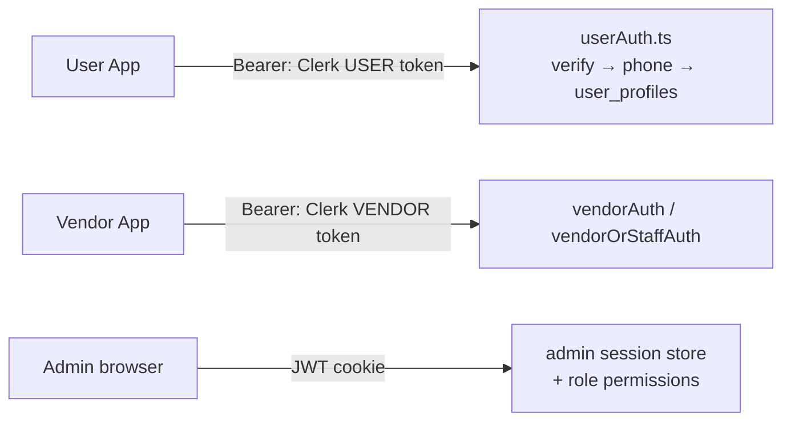
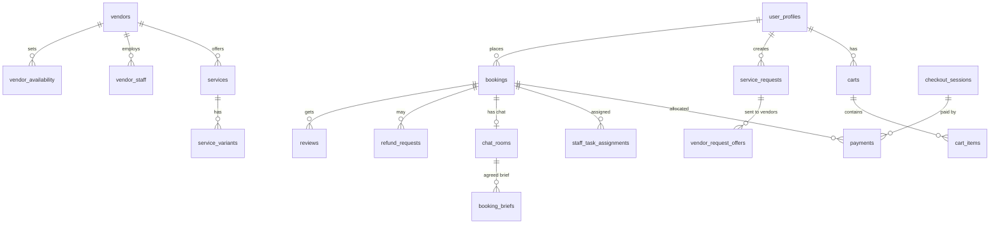

# 2. Backend + Admin Panel

**Repo:** `EKATRAA26DEV_BACKEND_PH2_PDU`. This is one Next.js 16 project that serves:
- the REST API for both mobile apps,
- the Admin web panel at `/admin`,
- webhooks and scheduled cron jobs.

## Folder hierarchy (`src/`)

```
src/
├── app/
│   ├── api/
│   │   ├── v1/          Main REST API (user, vendor, staff, admin, public, chat, webhooks)
│   │   ├── v2/          Marketplace V2 (services, variants, bundles, drafts, KYC, event discovery)
│   │   ├── admin/       Legacy admin media/services endpoints
│   │   ├── cron/        Scheduled jobs (secured by CRON_SECRET)
│   │   ├── internal/    Voice-worker callback
│   │   ├── webhooks/    Clerk, Sandbox KYC, WhatsApp
│   │   └── gift-cash/   Gift-cash ledger + PDF exports
│   ├── admin/           Admin panel pages (login, dashboard group)
│   ├── vendor-app/      Vendor app landing page
│   └── webhook/interakt Interakt webhook
├── middleware.ts        CORS, body-size limit, Clerk, admin session rotation
├── middleware/          userAuth.ts, vendorAuth.ts, vendorOrStaffAuth.ts
├── lib/                 ~100 domain helpers (bookings, cart, payments, refunds, KYC, notifications, PDFs…)
├── modules/             Layered domain code (repositories / services / schemas): customer, vendor, enquiries, briefs
├── mastra/              AI agents, sub-agents, tools, workflows
├── components/          Admin panel UI components
├── utils/               Supabase clients, response helpers, validation
└── types/
```

## Authentication model



- **Customer.** Clerk user instance (`USER_CLERK_*`). Login is by phone OTP, or by PIN (`/user/auth/pin/*`).
- **Vendor and staff.** Clerk vendor instance (`VENDOR_CLERK_*`). Login is by OTP over Interakt/Clerk SMS, or by PIN. Staff are linked to a vendor through `staff-binding`.
- **Admin.** Email and password (bcrypt, with an RSA-encrypted payload and rate limiting) return a `jose` JWT. Sessions rotate. Permissions come from the `admin_roles` and `admin_permissions` tables.
- **Dev bypass.** Applies only when `NODE_ENV=development`: send the `x-dev-user-id`, `x-dev-secret` and `x-dev-phone` headers. **QA: confirm this is rejected on staging and prod.**
- **Webhook verification.** Clerk uses svix. Razorpay, Interakt and Supabase use HMAC.

## Admin panel pages (`/admin`)

| Area | Pages |
|---|---|
| Access | login, forgot-password, reset-password, admin-users, roles |
| People | users, vendors (list / new / edit) |
| Catalog | services, catalog-categories, packages, vendor-packages, vendor-bundles, addons, offers |
| Operations | bookings, enquiries, refunds |
| Moderation | service-reviews, media-reviews |
| Content | event-discovery, festivals, banners, keywords, trending-searches, testimonials |
| Messaging | notifications, whatsapp-templates, e-invites |

## Database (Supabase Postgres)

There are 264 migrations in `supabase/migrations/`. A guard blocks destructive migrations unless the file explicitly allows them.



| Domain | Main tables |
|---|---|
| Users | `user_profiles`, `addresses`, `phone_pin_credentials`, `user_push_tokens` |
| Vendors | `vendors`, `vendor_profiles`, `vendor_kyc_verifications`, `vendor_bank_details` (encrypted), `vendor_staff`, `vendor_availability`, `vendor_capacity_holds` |
| Catalog | `categories`, `services`, `service_variants`, `service_options`, `service_addons`, `packages`, `vendor_bundles`, `price_brackets`, `category_payment_rules` |
| Cart / checkout | `carts`, `cart_items`, `checkout_sessions`, `package_drafts`, `package_draft_service_slots` |
| Enquiry | `service_requests`, `service_request_items`, `vendor_request_offers`, `vendor_booking_requests` |
| Bookings | `bookings`, `booking_start_otp`, `booking_completion_otp`, `booking_cancellation_requests`, `staff_task_assignments` |
| Money | `payments`, `payment_allocations`, `refund_requests`, `coupons`, `coupon_usages`, `disputes` |
| Chat / briefs | `chat_rooms`, `chat_messages`, `booking_briefs`, `booking_brief_versions`, `booking_brief_queries` |
| Notifications | `notifications`, `in_app_notifications`, `notification_worker.*`, `whatsapp_delivery_logs` |
| Admin / audit | `admin_profiles`, `admin_roles`, `admin_permissions`, `admin_sessions`, `audit_log` |
| Growth | `referrals`, `reward_ledger`, `gift_cash_entries`, `e_invite_templates` |

> Most server code uses the **service-role** client, which bypasses Row Level Security (RLS). Access control is therefore enforced inside each route handler, so test permission boundaries at the API level. For example, user A must not be able to read user B's order.

## Cron jobs (`vercel.json`)

| Job | Schedule | What it does |
|---|---|---|
| `vendor-timeout-reassignment` | every 15 min | Reassigns bookings when the vendor didn't respond in time |
| `milestone-dunning` | hourly | Chases outstanding milestone/balance payments |
| `kyc-aadhaar-sweep` | every 5 min | Polls pending Aadhaar verifications |
| `brief-maintenance` | every minute | Event-brief housekeeping |
| `brief-daily-maintenance` | 04:00 daily | Daily brief cleanup |
| `venue-combo-batches` | every minute | Processes venue-combo batch jobs |
| `account-retention` | 04:00 daily | Processes account deletions and retention |
| `gift-manager-ttl` | *not scheduled* | The route exists, but no schedule is set for it |

## External integrations
Clerk (2 instances), Supabase, Razorpay, Interakt (WhatsApp/SMS), Expo Push, Google Maps/Places, Sandbox.co.in KYC, Upstash Redis, Anthropic, Gemini, OpenRouter, Mastra, and Pipecat voice.

## Feature flags
`MARKETPLACE_V2_ENABLED`, `VENDOR_AI_ENABLED`, `VENDOR_AI_WRITES_ENABLED`, `ALLOW_TEST_COUPON`. **QA: record which flags are on in each environment you test.**

## Further dev docs (inside the backend repo)
`docs/API_FLOWS.md`, `docs/END_TO_END_PLATFORM_ARCHITECTURE.md`, `docs/CLERK_AUTH_FLOW.md`, `docs/VENDOR_REQUEST_ACCEPTANCE_CHECKOUT_ARCHITECTURE.md`, `docs/NOTIFICATION_SERVICE_ARCHITECTURE.md`, `docs/OUTSTANDING_AMOUNT_MILESTONE_ARCHITECTURE.md`.
