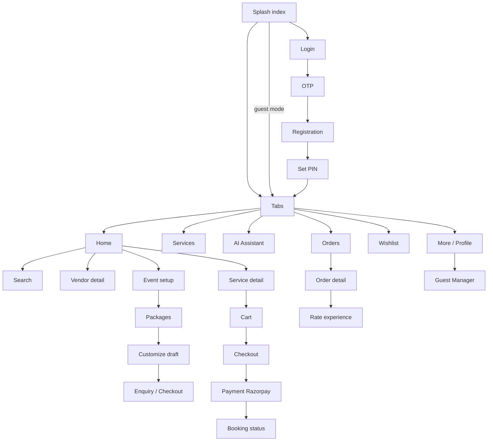

# 3. User App (Customer)

**Repo:** `Ekatraa26Dev_User_App_EK20JUCODE`
**Bundle / package:** `com.ekatraa2025.ekatraauserv1`, version 1.0.10, URL scheme `expotemp://`

Customers use the app to find and book vendors for occasions: pay online, track orders, chat with vendors and manage event guests.

## Stack
Expo SDK 56, React Native 0.85, expo-router, Zustand and React Query, Axios, and Clerk for auth. Payments run through Razorpay inside a WebView. Other libraries: react-native-maps, expo-notifications, expo-contacts, expo-speech-recognition (voice search), expo-video (reels), expo-print (PDF). The app is translated into English, Hindi and Odia.

**Permissions:** contacts, location, notifications, microphone.

## Folder hierarchy
```
app/            Screens (file-based routes)
api/api.ts      Axios clients: /api/v1 and /api/v2, Clerk token attached
services/       ~30 API wrappers, one per feature
hooks/          ~44 React Query hooks
store/          16 Zustand stores
components/     UI by feature (home, vendors, cart, orders, packages, chat…)
src/locales/    en / hi / or translations
tests/          node:test unit tests
docs/           Storybook
```

## Screen map



| Feature | Screens (`app/…`) |
|---|---|
| Auth / onboarding | `index` (splash), `onboarding`, `choose-language`, `login`, `otp`, `registration`, `set-pin`, `security` |
| Tabs | `(tabs)/index` Home, `services`, `ai`, `orders`, `wishlist`, `more` |
| Discovery | `search`, `all-services`, `services/*`, `category/[id]`, `reels`, `offers/[id]`, `testimonials` |
| Vendors | `vendor/[id]`, `vendor/category/[slug]`, `vendor/compare`, `venue-combo`, `catering-packages` |
| Events and packages | `event-setup/step1`, `step2`, `custom-request`, `all-festivals`, `occasions/*`, `packages/[festival_id]`, `packages/customize/[draft_id]`, `…/vendors/[service_id]`, `…/review/[draft_id]`, `packages/enquiry/[draft_id]` |
| Enquiries | `request`, `requests`, `review-request`, `booking-brief` |
| Buying | `cart`, `checkout`, `payment`, `booking-status/[booking_id]` |
| Orders | `order/[id]` (cancel / resubmit / review), `rate-experience` |
| Chat | `chat/[vendorId]`, `vendor-chat` |
| Guest Manager | `guest-manager/index`, `[list_id]`, `dashboard`, `templates`, `canvas`, `ai`, `plans`, `send` |
| Profile / misc | `profile`, `addresses`, `notifications`, `help`, `about`, `terms`, `deleteaccount` |
| ⚠️ Dev screens | `test-cart`, `test-filter`, `test-occasions`, `test-services`, `test-vendor` (are these reachable in release builds?) |

## State stores (Zustand)
| Store | Holds |
|---|---|
| `useUserStore` | Profile and auth status |
| `useCartStore` / `useRequestCartStore` | Cart items |
| `useGuestDiscoveryStore` | Guest mode, the guest's cart and event details |
| `usePendingActionStore` | What a guest was trying to do, replayed after login |
| `useEventContextStore` | Event type, dates, location, guest count |
| `usePackageCustomizationStore` | Vendor chosen for each package slot |
| `useGuestStore` / `useMessagingStore` | Guest lists, gift logs, messaging credits and jobs |
| `useAiChatStore` | AI chat |
| `useUserNotificationStore` / `useNotificationStore` | Inbox and toast banners |
| `useRecentStore`, `useServicesBrowseStore`, `useUiStore`, `useWishlistPickerStore` | Small UI state |

## Backend communication
- All calls go to `EXPO_PUBLIC_API_URL` (`/api/v1` and `/api/v2`). Each request carries the header `x-ekatraa-client: mobile-app` and a Clerk Bearer token. The timeout is 10 s.
- Supabase is used **only for Realtime**, to push live enquiry and offer updates. The app reads no tables directly.
- ⚠️ `services/ai.service.ts` calls **Google Gemini directly from the app**, with the API key in the bundle.
- See [05-api-reference.md](05-api-reference.md) for the endpoint list.

## Push notifications and deep links
- The Expo push token is registered at `/user/push-tokens` and removed on logout.
- Tapping a notification opens the route given in its payload.
- Scheme: `expotemp://`. All file routes can be opened as deep links.
