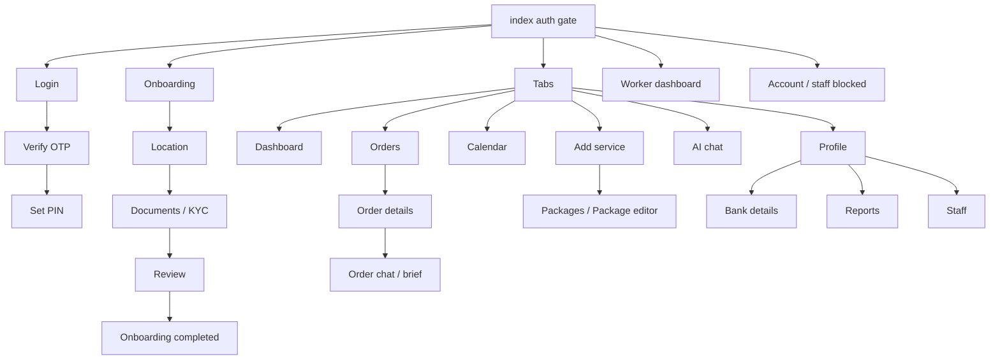

# 4. Vendor App

**Repo:** `Ekatraa26Dev_Vendor_App_EK20JUCODE`
**Bundle / package:** `com.ekatraa2025.ekatraavendorv1`, version 1.0.14, URL scheme `ekatraavendor://`

Vendors use the app to:
- receive enquiries and booking requests, then accept or decline them
- run events (start and complete with an OTP, assign staff)
- manage their services, packages and availability
- view earnings reports
- chat with customers

Staff and workers sign in to the same app and get a simpler **worker dashboard**.

## Stack
Expo SDK 57, React Native 0.86, expo-router, Zustand and React Query, Axios, Clerk, PostHog analytics. Translated into English, Hindi and Odia.

Native extras:
- **Incoming-enquiry ringer**, a full-screen modal with a custom ringtone
- **iOS notification extensions** and a Live Activity
- a home-screen widget (`VendorOverviewWidget`)
- Android in-app force update
- maps and the image picker

## Folder hierarchy
```
app/                 Screens
  (tabs)/            Dashboard, Orders, Calendar, Add-service, AI chat, Profile
  staff/  booking-requests/
components/          UI by feature (onboarding, orders, services, availability, staff, worker…)
services/            API wrappers (account, chat, enquiry, push, reports, venueCombo…)
store/               Zustand stores
hooks/               Bookings, realtime enquiries, ringer, push, force update
modules/enquiry-responder   Custom iOS native module (respond from notification)
plugins/             Expo config plugins (notification extensions, widget)
i18n/                en / hi / or
deep-link-hosting/   nginx + .well-known files for ekatraa.in/vendor-app
tests/               Standalone node test scripts
```

## Screen map



| Feature | Screens (`app/…`) |
|---|---|
| Entry / auth | `index` (gate), `login`, `verify-otp`, `set-pin`, `account-blocked`, `staff-blocked` |
| Onboarding / KYC | `onboarding`, `onboarding-location`, `business-location-picker`, `onboarding-documents`, `onboarding-review`, `onboarding-completed`, `identity-reveal`, `terms-and-conditions` |
| Catalog | `(tabs)/add-service`, `packages`, `package-editor` |
| Orders / bookings | `(tabs)/orders`, `booking-requests/[id]`, `order-details`, `order-chat`, `order-brief` |
| Calendar | `(tabs)/calendar` |
| Money | `reports`, `bank-details` (there is no dedicated payout screen; settlement happens on the backend) |
| Profile | `(tabs)/profile`, `business-info`, `profile-preview`, `reviews`, `settings`, `privacy`, `support`, `notifications` |
| Staff / worker | `staff/index`, `staff/[id]`, `worker-dashboard`, `worker-task` |
| Global overlays | `ForceUpdateScreen`, `IncomingEnquiryModal` |

## State stores
| Store | Holds |
|---|---|
| `useAuthStore` | Role (vendor / staff / worker), session, profile, `approvalStatus` |
| `useOnboardingStore` | Onboarding form data |
| `useServicesStore` | Services, variants, add-ons |
| `useAvailabilityStore` | Calendar (optimistic updates with rollback) |
| `useStaffStore`, `useAssignmentStore`, `useWorkerTaskStore` | Staff, booking assignments, worker tasks |
| `useIncomingEnquiryStore`, `useEnquiryConnectionStore` | Queue of incoming offers, realtime connection state |
| `useNotificationStore`, `useReportsStore`, `useLocaleStore` | Inbox, reports (Week, Month, Quarter, Year), language |

## Backend communication
- Base URL: `EXPO_PUBLIC_API_URL`. If it's missing, the app falls back to the **production** admin host. Headers: `x-ekatraa-client: vendor-app`, `x-app-version`, and a Clerk Bearer token. Timeout: 15 s.
- Supabase is used **only for Realtime**, on a private channel for incoming enquiries. The backend provides the channel config at `/vendor/service-requests/realtime`.

## Push notifications and deep links
- Enquiry push payload: `type=vendor_enquiry`, `offer_id`, `respond_by`. It has **Accept** and **Reject** action buttons.
- Unknown routes open `/notifications`. `https` URLs open in the browser.
- Universal and App Links: `https://ekatraa.in/vendor-app` only launches the app, with no deep routing.
- ⚠️ **iOS notification extensions and the Live Activity: the dev handoff doc says the Swift code has never been compiled.**
