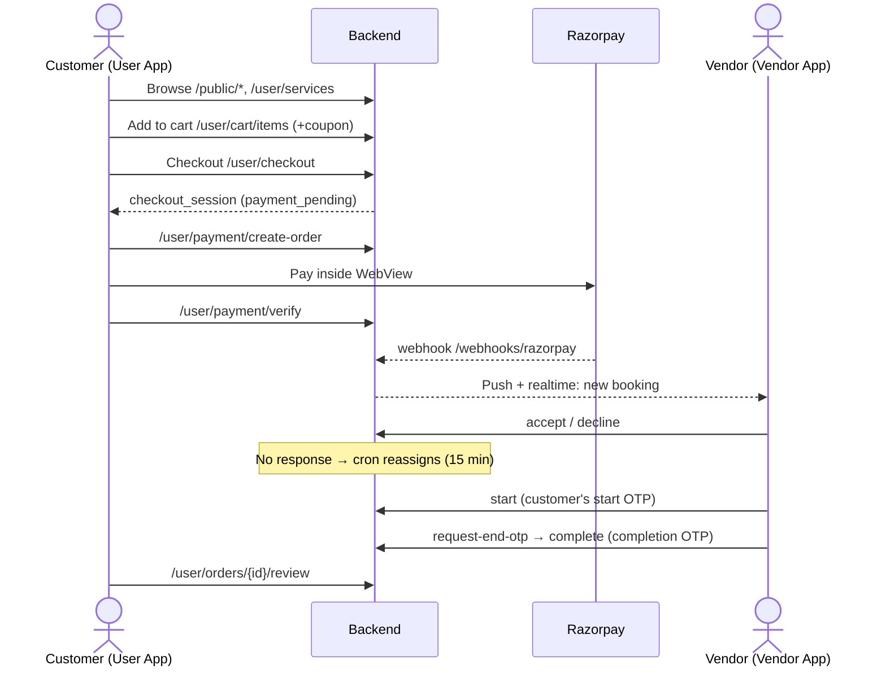
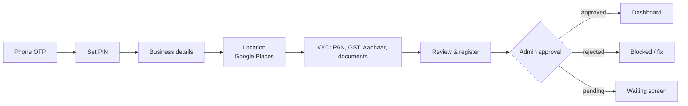
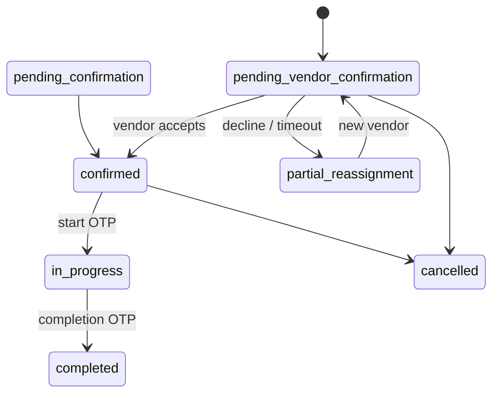

# 6. End-to-end Journeys and Status Lifecycles

## Journey A: Customer direct booking (cart → pay)

## Journey B: Enquiry / RFP (customer asks, vendors quote)
1. The customer creates a service request (`/user/service-requests`, then `/send`).
2. The backend sends an **offer** to matching vendors (offer status `notified`). The vendor's phone **rings**: a push notification with Accept/Reject buttons and a full-screen modal.
3. The vendor responds: `/vendor/service-requests/offers/{id}/respond`, which sets the offer to `accepted` or `rejected`. If nobody responds in time, it becomes `expired`.
4. The customer sees offers in real time and adds one to the cart (`/offers/{id}/add-to-cart` or `claim`). From there the flow is the same as Journey A.

## Journey C: Festival / event package
1. Event setup: type, date, location, guest count.
2. Pick a festival, then a package. The backend creates a **draft** (v2 `/user/drafts`).
3. Pick a vendor for each slot (`PATCH /drafts/{id}/slots/{slotId}`).
4. Review the draft, then either send an enquiry (`/drafts/{id}/enquiry`) or go to checkout.
5. Admin can see unassigned package slots and assign vendors.

## Journey D: Guest login handoff
A guest can browse and build a cart without logging in. When they try to check out, book or send a request, the app saves the **pending action**, sends them to log in, then **replays** that action. Test every entry point.

## Journey E: Vendor onboarding

After approval, the vendor adds a service, which goes through **admin review** before it is visible to customers. If an admin edits a service, the vendor must accept the new terms again.

## Journey F: Staff / worker
The vendor creates staff, then assigns, reassigns or drops them on a booking. The worker logs in, sees tasks on the worker dashboard and updates task status (`/staff/tasks/{id}/status`).

## Journey G: Guest Manager (User App)
1. Create a guest list (manual entry or contacts import).
2. Design an invitation: template, canvas, or AI-written text.
3. Buy a messaging plan.
4. Send over WhatsApp (Interakt).
5. Watch the delivery dashboard. Gift-cash ledger and PDF export are also here.

---

## Status lifecycles (values QA will see in the DB and API)

### Booking

*(The exact transitions are inferred from the API names. Confirm edge cases with the dev team.)*

| Entity | Status values |
|---|---|
| Checkout session | `draft` → `payment_pending` → `paid` / `failed` / `expired` / `reconciliation_required` |
| Cart | `active`, `payment_pending`, `converted`, `abandoned` |
| Capacity hold | `active`, `converted`, `released`, `expired` |
| Package draft | `draft`, `enquiry_sent`, `booked`, `cancelled` |
| Service request | `draft`, `pending`, `completed`, `cancelled` |
| Vendor offer | `notified`, `accepted`, `rejected`, `expired` |
| Booking / cancellation request | `pending`, `accepted`, `declined`, `superseded` |
| Refund request | `pending_review`, `approved`, `denied`, `processing`, `refunded`, `failed` |
| Vendor service (V2) | `draft`, `pending_review`, `published`, `rejected`, `inactive`, `pending_terms_acceptance` |
| Media / revisions | `draft`, `pending_review`, `approved`, `rejected`, `withdrawn` |
| Vendor approval | `pending`, `approved`, `rejected`, `suspended` |
| KYC | `pending`, `approved`, `rejected` |
| User | `active`, `suspended`, `deleted` |
| Event brief version | `draft` → `pending_approval` → `agreed` / `superseded` / `rejected` |
| Dispute | `none`, `open`, `resolved` |
| Coupon | `active`, `inactive`, `archived` (percentage or fixed) |

### Payment types
- **Full**: the whole amount is paid at checkout.
- **Advance + balance**: `create-balance-order` and `verify-balance`.
- **Milestone**: `create-milestone-order` and `verify-milestone`. If a milestone is unpaid, the hourly **dunning** cron follows up.
- **Refunds**: the customer cancels, an admin reviews the refund request, and Razorpay processes the refund.
